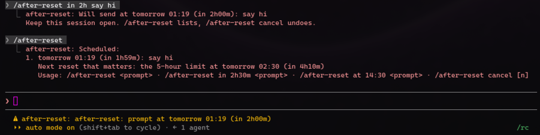

# after-reset

Queues a prompt to send once your usage limit resets, or at a time you choose.

```
/after-reset <prompt>               send after the next reset that matters
/after-reset in 2h30m <prompt>      send after a wait (h, m, or both)
/after-reset at 14:30 <prompt>      send at the next 14:30, local time
/after-reset                        list what's queued and the next reset
/after-reset cancel [n | all]       cancel prompt n, or all of them
```

- A reset-timed prompt goes 2 minutes after the reset. If any window is full, it waits for the last of the full windows to reset. Otherwise it waits for the nearest reset.
- If a window is still full when a prompt comes due, the prompt waits for that window to reset.
- Prompts are sent as if you had typed them, so keep the session open. A status line shows the next one, for example `after-reset: prompt at 14:32 (in 2h01m)`.
- The queue survives `/clear`; a toast says how many prompts were kept. Due prompts go one at a time, and one that can't be sent stays queued and is tried again 5 minutes later.
- When a turn is cut off by the usage limit and nothing is queued yet, a toast suggests `/after-reset continue`.
- The reset time is learned from Claude Code's first reply and remembered across sessions. Until it's known, use `in` or `at`.



*Queuing a prompt, listing the queue, and the status line counting down.*

## Install

```bash
claude plugin marketplace add cloudaura-io/cloudaura-marketplace
claude plugin install after-reset@cloudaura-marketplace
```

## Tests

```bash
claude plugin test plugins/after-reset
```
